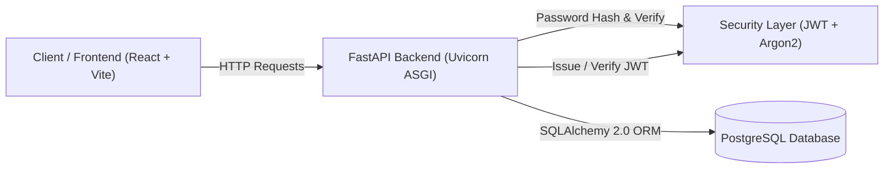
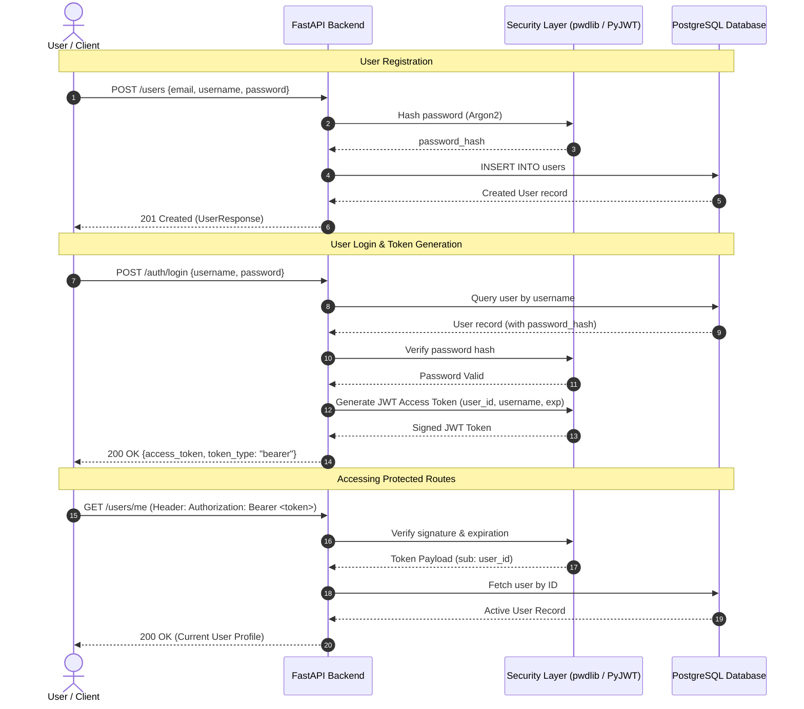
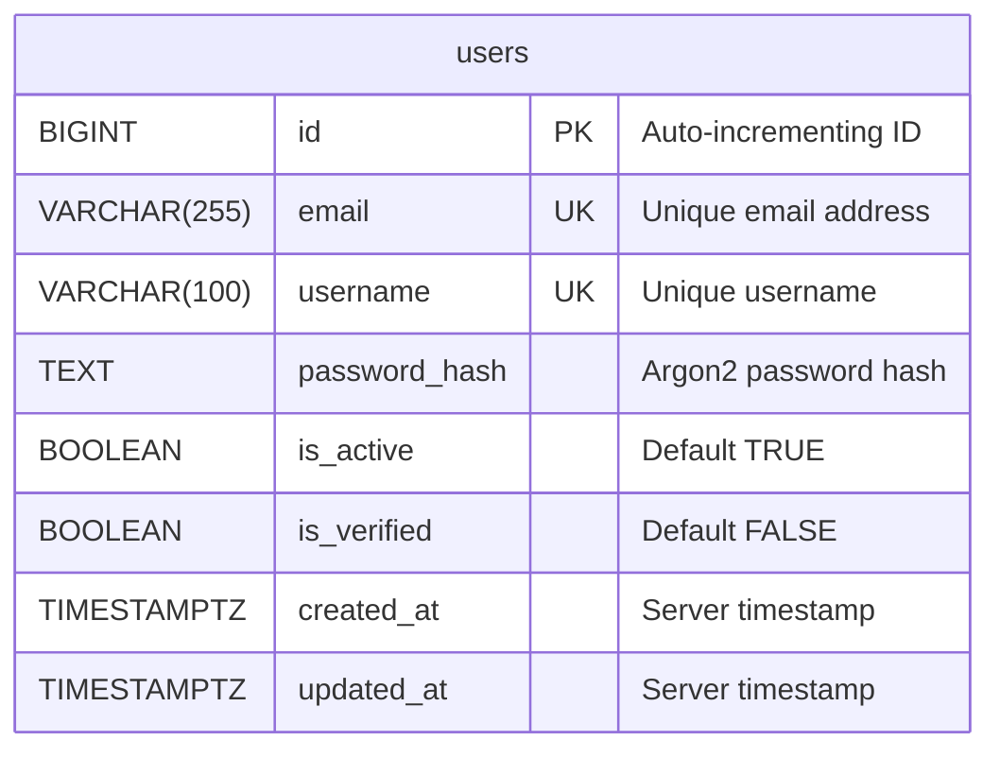

# Auth_forge

<div align="center">


**A modern, production-ready full-stack authentication system built with FastAPI, SQLAlchemy, PostgreSQL, and React (Vite).**

[Features](#-key-features) • [Architecture](#-architecture) • [Getting Started](#-getting-started) • [API Reference](#-api-endpoints) • [Database](#-database-schema) • [Environment Variables](#-environment-variables)

</div>

---

## 📖 Table of Contents

- [Overview](#-overview)
- [Key Features](#-key-features)
- [Architecture & Authentication Flow](#-architecture--authentication-flow)
- [Tech Stack](#-tech-stack)
- [Project Structure](#-project-structure)
- [Prerequisites](#-prerequisites)
- [Getting Started](#-getting-started)
  - [1. Clone Repository](#1-clone-repository)
  - [2. Database Setup](#2-database-setup-postgresql)
  - [3. Backend Setup (FastAPI)](#3-backend-setup-fastapi)
  - [4. Frontend Setup (React + Vite)](#4-frontend-setup-react--vite)
- [Database Schema & Table Initialization](#-database-schema)
- [API Endpoints](#-api-endpoints)
- [Environment Variables](#-environment-variables)
- [Security Features](#-security-features)
- [Contributing & License](#-contributing--license)

---

## 🌟 Overview

**Auth_forge** is a clean, scalable authentication template and microservice designed to handle user lifecycle management, enterprise-grade password security with **Argon2**, and stateless session management with **JSON Web Tokens (JWT)**.

It pairs a high-performance **FastAPI** backend running asynchronous ASGI workers with a fast **React + Vite** frontend.

---

## ⚡ Key Features

- **Argon2 Password Hashing**: State-of-the-art password hashing using `pwdlib` and `argon2-cffi` to protect against GPU-based brute-force attacks.
- **Stateless JWT Authorization**: Bearer token creation, signing, expiration tracking, and cryptographic signature validation (`PyJWT`).
- **Protected Endpoints (`/users/me`)**: Reusable FastAPI dependency injection pipeline (`HTTPBearer`) with automated database user resolution.
- **Relational Integrity with PostgreSQL & SQLAlchemy**: Full ORM integration using SQLAlchemy 2.0 with the modern `psycopg` driver.
- **Data Validation & Typing**: Strict request/response payload validation via Pydantic V2 and email validation.
- **Interactive Documentation**: Auto-generated interactive Swagger UI and ReDoc endpoints out of the box.
- **Modern Vite + React Frontend**: Lightweight client-side application pre-configured with Oxlint and HMR.
- **Docker Compose Ready**: Zero-configuration local database orchestration.

---

## 📐 Architecture & Authentication Flow

### High-Level System Architecture



### JWT Authentication Flow



---

## 🛠 Tech Stack

### Backend
| Technology | Role |
| :--- | :--- |
| **Python 3.10+** | Programming Language |
| **FastAPI** | High-performance Web Framework |
| **Uvicorn** | ASGI Web Server |
| **SQLAlchemy 2.0** | Object Relational Mapper (ORM) |
| **psycopg (v3)** | Modern PostgreSQL Database Driver |
| **Pydantic V2** | Request validation & Schema Serialization |
| **pwdlib & argon2-cffi** | Password Hashing (Argon2) |
| **PyJWT** | JSON Web Token Generation and Verification |
| **python-dotenv** | Environment Configuration Loader |

### Frontend
| Technology | Role |
| :--- | :--- |
| **React 19** | UI Library |
| **Vite 6** | Frontend Tooling & Dev Server |
| **Oxlint** | High-performance JavaScript/JSX Linter |

---

## 📂 Project Structure

```text
Auth_forge/
├── .env.example             # Template for environment variables
├── .gitignore               # Comprehensive Git ignore rules
├── CONTRIBUTING.md          # Development and contribution guide
├── docker-compose.yml       # Local PostgreSQL database container configuration
├── LICENSE                  # MIT License
├── README.md                # Project documentation
├── requirements.txt         # Backend Python dependencies
├── SECURITY.md              # Security policies and vulnerability reporting
│
├── app/                     # Backend Application Source
│   ├── __init__.py          # Package initialization
│   ├── crud.py              # Database queries & user creation routines
│   ├── database.py          # SQLAlchemy engine, session maker, DB dependency
│   ├── dependencies.py      # Auth dependencies (get_current_user via Bearer token)
│   ├── main.py              # FastAPI application instance and route handlers
│   ├── models.py            # SQLAlchemy ORM Database models (User)
│   ├── schemas.py           # Pydantic schemas (UserCreate, UserResponse, Token, etc.)
│   └── security.py          # Password hashing and JWT generation/decoding
│
├── docs/                    # Additional Documentation
│   └── API.md               # Detailed API specification and curl examples
│
└── frontend/                # Frontend Application Source (React + Vite)
    ├── index.html           # Single Page Application HTML entry point
    ├── package.json         # Node.js dependencies and scripts
    ├── vite.config.js       # Vite build & plugin configuration
    ├── public/              # Static SVG icons and favicon
    └── src/
        ├── App.css          # App styling
        ├── App.jsx          # Main React Application component
        ├── index.css        # Global CSS stylesheet
        └── main.jsx         # React DOM mount point
```

---

## 📋 Prerequisites

Before running the project, ensure you have:

- **Python**: Version `3.10` or higher ([python.org](https://www.python.org/downloads/))
- **PostgreSQL**: Version `14` or higher (or Docker installed)
- **Node.js**: Version `18.0.0` or higher & `npm` ([nodejs.org](https://nodejs.org/))

---

## 🚀 Getting Started

### 1. Clone Repository

```bash
git clone https://github.com/<your-username>/Auth_forge.git
cd Auth_forge
```

---

### 2. Database Setup (PostgreSQL)

You can run PostgreSQL either through Docker (recommended) or a local installation.

#### Option A: Using Docker (Quickest)
Run the bundled Docker Compose file to start a pre-configured PostgreSQL instance:
```bash
docker compose up -d
```

#### Option B: Using Local PostgreSQL
1. Start your local PostgreSQL server.
2. Create the target database using `psql` or pgAdmin:
   ```sql
   CREATE DATABASE auth_service;
   ```

---

### 3. Backend Setup (FastAPI)

#### 3.1. Create and Activate a Virtual Environment

- **On Windows (PowerShell)**:
  ```powershell
  python -m venv .venv
  .\.venv\Scripts\Activate.ps1
  ```
- **On macOS / Linux**:
  ```bash
  python3 -m venv .venv
  source .venv/bin/activate
  ```

#### 3.2. Install Python Dependencies
```bash
pip install -r requirements.txt
```

#### 3.3. Configure Environment Variables
Create your local `.env` file by copying `.env.example`:
```bash
# Windows
copy .env.example .env

# macOS / Linux
cp .env.example .env
```

Ensure the credentials in `.env` match your PostgreSQL database setup:
```env
DB_HOST=localhost
DB_PORT=5432
DB_NAME=auth_service
DB_USER=postgres
DB_PASSWORD=your_postgres_password_here

JWT_SECRET_KEY=generate-a-strong-random-secret-key-here
JWT_ALGORITHM=HS256
ACCESS_TOKEN_EXPIRE_MINUTES=15
```

> **Tip**: Generate a cryptographic secret key by executing:
> ```bash
> python -c "import secrets; print(secrets.token_hex(32))"
> ```

#### 3.4. Initialize Database Tables
Initialize the database tables using Python with the existing SQLAlchemy models:
```bash
python -c "from app.database import engine, Base; from app import models; Base.metadata.create_all(bind=engine); print('Database tables initialized successfully!')"
```
*(Alternatively, execute the [SQL DDL script](#-database-schema) directly in PostgreSQL).*

#### 3.5. Run the FastAPI Server
Start Uvicorn with hot-reload enabled:
```bash
uvicorn app.main:app --reload --host 127.0.0.1 --port 8000
```

- API Base URL: `http://localhost:8000`
- Interactive Swagger UI: `http://localhost:8000/docs`
- ReDoc UI: `http://localhost:8000/redoc`

---

### 4. Frontend Setup (React + Vite)

Open a new terminal tab and navigate into the `frontend` directory:

```bash
cd frontend
npm install
npm run dev
```

The frontend will run at `http://localhost:5173`.

---

## 🗄 Database Schema

The database model is mapped to the `users` table:



### Manual SQL DDL (Optional)

If you prefer to initialize the schema via PostgreSQL SQL directly:

```sql
CREATE TABLE IF NOT EXISTS users (
    id BIGSERIAL PRIMARY KEY,
    email VARCHAR(255) NOT NULL UNIQUE,
    username VARCHAR(100) NOT NULL UNIQUE,
    password_hash TEXT NOT NULL,
    is_active BOOLEAN DEFAULT TRUE,
    is_verified BOOLEAN DEFAULT FALSE,
    created_at TIMESTAMPTZ DEFAULT CURRENT_TIMESTAMP,
    updated_at TIMESTAMPTZ DEFAULT CURRENT_TIMESTAMP
);

CREATE INDEX IF NOT EXISTS ix_users_id ON users (id);
```

---

## 📡 API Endpoints

A summary of available endpoints. For full payload schemas, query parameters, and error responses, see [docs/API.md](docs/API.md).

| Method | Route | Description | Auth Required |
| :--- | :--- | :--- | :--- |
| `GET` | `/` | Health check / API status message | No |
| `POST` | `/users` | Create / Register a new user | No |
| `POST` | `/auth/login` | Authenticate credentials & issue JWT token | No |
| `GET` | `/users/me` | Fetch authenticated user profile | **Yes (Bearer JWT)** |
| `GET` | `/users/{user_id}` | Fetch public user profile by ID | No |

### Quick Examples

#### 1. Register a User
```bash
curl -X POST http://localhost:8000/users \
  -H "Content-Type: application/json" \
  -d '{
    "email": "developer@example.com",
    "username": "coder123",
    "password": "SuperSecurePassword123!"
  }'
```

#### 2. Log In & Receive JWT
```bash
curl -X POST http://localhost:8000/auth/login \
  -H "Content-Type: application/json" \
  -d '{
    "username": "coder123",
    "password": "SuperSecurePassword123!"
  }'
```
Response:
```json
{
  "access_token": "eyJhbGciOiJIUzI1NiIsInR5cCI6IkpXVCJ9...",
  "token_type": "bearer"
}
```

#### 3. Access Protected Route (`/users/me`)
```bash
curl -X GET http://localhost:8000/users/me \
  -H "Authorization: Bearer <your_access_token_here>"
```

---

## ⚙ Environment Variables

| Variable | Default Value | Description |
| :--- | :--- | :--- |
| `DB_HOST` | `localhost` | PostgreSQL host address |
| `DB_PORT` | `5432` | PostgreSQL port |
| `DB_NAME` | `auth_service` | PostgreSQL database name |
| `DB_USER` | `postgres` | PostgreSQL username |
| `DB_PASSWORD` | *(None)* | PostgreSQL user password |
| `JWT_SECRET_KEY` | *(Required)* | Secret key used to sign and verify JWT tokens |
| `JWT_ALGORITHM` | `HS256` | Cryptographic algorithm for JWT signatures |
| `ACCESS_TOKEN_EXPIRE_MINUTES`| `15` | Expiration window for access tokens |

---

## 🔒 Security Features

1. **Argon2 Password Hashing**:
   Uses the `pwdlib` recommended default (`argon2-cffi`), resisting side-channel and parallel hardware brute-force attacks.
2. **Stateless JWT Claims**:
   JWTs include standard `sub` (subject user ID), `username`, `iat` (issued at), and `exp` (expiration timestamp) claims.
3. **Active Account Verification**:
   Inactive users (`is_active = false`) are rejected at login (`403 Forbidden`) and blocked from accessing protected routes even if holding an unexpired token.
4. **Header Validation**:
   Uses FastAPI's `HTTPBearer` security dependency to cleanly inspect the `Authorization: Bearer <token>` header.

---

## 🤝 Contributing & License

- **Contributing**: Please review [CONTRIBUTING.md](CONTRIBUTING.md) before submitting pull requests.
- **Security**: For reporting security issues, refer to [SECURITY.md](SECURITY.md).
- **License**: This project is licensed under the [MIT License](LICENSE).
